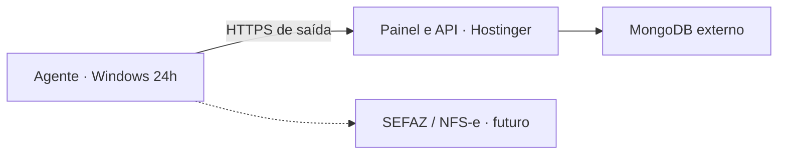

# TRIBUTO · Maximum Contábil

Plataforma de trabalho consultivo com painel web, API e agente para o servidor Windows da Maximum. O painel centraliza empresas, usuários e permissões por módulo. O agente se comunica por HTTPS de saída e mantém a fila de documentos no Windows até a API confirmar a gravação.

## O que já funciona

| Área | Entrega atual | Próxima integração |
| --- | --- | --- |
| Acesso | Configuração única do primeiro administrador, login, sessões, troca de senha, permissões por módulo e CNPJ, auditoria de ações. | Convites e recuperação de acesso, se necessários. |
| Empresas/equipe | Cadastro de empresas, usuários, carteiras e permissões. | Importação da carteira existente da Maximum. |
| Fiscal | Listagem e download protegido dos XMLs recebidos pela API, tarefas de acompanhamento e visão da saúde do agente. | Conectores oficiais NF-e/NFS-e, eventos, solicitações de cancelamento e análises IBS/CBS. |
| DP, Contábil, Societário, Financeiro, Gestão | Espaços e atividades vinculadas a empresa e responsável, com permissões separadas. | Fluxos e indicadores específicos de cada setor. |
| Agente | Cadastro e revogação pelo administrador, token exibido uma vez, heartbeat, fila persistente, confirmação de lote, quarentena de arquivo inválido. | Captura fiscal com A1/procuração e conectores municipais. |

**A coleta de notas fiscais ainda não foi implementada.** O agente atual transporta apenas lotes que outro componente inserir em sua fila. Ele não emite, manifesta ou cancela notas. O A1 e sua senha permanecerão no Windows quando os conectores forem adicionados.

## Arquitetura

O painel e a API rodam no mesmo processo Node.js. Dados de usuários, empresas, atividades e XMLs ficam no MongoDB com backup; os XMLs são cifrados antes de gravar no banco. O token do agente fica no Windows com DPAPI e permissões restritas. A publicação na Hostinger não armazena PFX, fila nem arquivos persistentes.

## Publicação e instalação

1. Configure um MongoDB com transações e as variáveis secretas descritas em [docs/HOSTINGER.md](docs/HOSTINGER.md).
2. Importe este repositório privado em **Hostinger Web Apps**, com Node 22/24 e `src/api/main.mjs` como arquivo de entrada. O painel será servido na raiz do domínio e a API em `/v1/`.
3. Abra o domínio em HTTPS, use o código de configuração inicial para criar o administrador e cadastre empresas e acessos.
4. Crie o agente no painel, copie o token exibido uma vez e instale no servidor Windows conforme [docs/WINDOWS-INSTALL.md](docs/WINDOWS-INSTALL.md).
5. Confira o heartbeat em **Agentes de coleta**. As notas só aparecerão após integrar um conector autorizado ou enviar lotes válidos à API.

Para desenvolvimento local, configure `MONGODB_URI`, `MONGODB_DB`, `XML_ENCRYPTION_KEY`, `BOOTSTRAP_ADMIN_TOKEN_SHA256`, `COOKIE_SECURE=false`, `HOST` e `PORT` no ambiente do processo; o Node não lê `.env` automaticamente. Use `npm ci`, `npm test` e `npm start`.

Leia [docs/API.md](docs/API.md) para o protocolo de sincronização e [docs/AGENT.md](docs/AGENT.md) para a operação da fila. Nenhum certificado, senha ou XML real acompanha o código.
