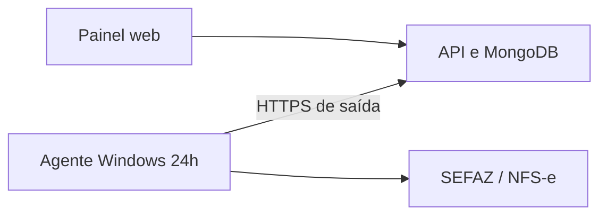

# TRIBUTO

Base do módulo fiscal consultivo da Maximum Contábil. Nesta primeira entrega, há uma **API de sincronização** e um **agente de transporte para Windows**. O coletor ainda **não consulta notas fiscais**, e não existe painel de notas nesta versão. A arquitetura separa a coleta local da visualização web e mantém o A1 no servidor da contabilidade.

## O que funciona agora

- API recebe heartbeat, entrega uma lista restrita de tarefas de leitura e persiste lotes XML com checkpoint por CNPJ/fonte.
- Agente consulta a API via HTTPS de saída, possui fila local persistente e reenvia lotes até receber confirmação.
- Token exclusivo por instalação é verificado pela API; cada token tem escopo de CNPJs e fontes.
- Lotes com o mesmo `batchId` são idempotentes; um ID reutilizado com conteúdo diferente é rejeitado.
- Testes cobrem autenticação, isolamento por CNPJ, heartbeat, confirmação repetida e XML adulterado.

## Arquitetura prevista



**A seta para os serviços fiscais é futura.** O agente presente só transporta lotes previamente colocados em sua fila, sem executar consultas oficiais. O certificado A1 e sua senha permanecerão no Windows quando implementarmos os conectores. A aplicação web não poderá pedir execução de comandos, emissão, cancelamento ou manifestação automática.

## Instalação de desenvolvimento

Requer Node.js 20+ e MongoDB com suporte a transações (replica set, como MongoDB Atlas). A API deve usar HTTPS através da hospedagem/proxy em produção. Os XMLs são cifrados pela API antes de ir ao banco, usando `XML_ENCRYPTION_KEY`; cuide do backup da chave.

```bash
npm ci
cp .env.example .env
# Configure as variáveis no ambiente do processo. O Node não carrega .env automaticamente.
npm run api
```

No PowerShell, configure as variáveis de ambiente do processo com `$env:NOME = 'valor'`, depois rode `npm run api`. Nunca comite `.env`. Gere o token e o hash como descrito em [docs/API.md](docs/API.md), configure `AGENT_TOKENS_JSON` na API e `AGENT_TOKEN` no servidor Windows. O `COLLECTOR_JOBS_JSON` define quais CNPJs/fontes aparecerão ao agente; configure um CNPJ real autorizado antes de ativar coleta.

```powershell
npm ci
$env:API_BASE_URL = 'https://SEU-DOMINIO-DA-API'
$env:AGENT_TOKEN = 'SEGREDO_GERADO_LOCALMENTE'
$env:AGENT_STATE_DIR = 'C:\Tributo\dados-agente'
node src/agent/agent.mjs --once
```

Leia [docs/AGENT.md](docs/AGENT.md) para execução contínua no Windows e [docs/API.md](docs/API.md) para o contrato e os limites.

## Próximas etapas

1. Autenticação de usuários e painel fiscal com acesso por carteira de empresas.
2. Conector NF-e recebida via distribuição oficial, usando A1 do CNPJ correspondente e NSU.
3. Conector NFS-e nacional com acesso válido do cliente e tratamento de municípios sem dados no ADN.
4. Visualização e download protegido dos XMLs, eventos oficiais, solicitações de cancelamento e alertas.
5. Regras consultivas versionadas para IBS/CBS.

Nenhuma credencial, certificado ou XML real é incluído no repositório. Antes de produção, configurar backup, retenção, monitoramento e controles de acesso ao banco e aos XMLs.
