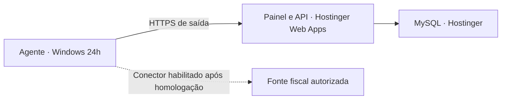

# TRIBUTO · Maximum Contábil

Painel consultivo em **Hostinger Web Apps (Node.js)**, API e agente para o servidor Windows 24 horas da Maximum. O sistema organiza empresas, equipe e permissões por módulo/CNPJ. A área Fiscal oferece uma ficha por empresa com NFS-e prestadas e tomadas, filtros, totais por competência e indicação do último lote recebido. Os registros fiscais no MySQL da Hostinger armazenam metadados. O cadastro de clientes mantém certificados A1 em um cofre cifrado separado.

## Estado das funcionalidades

| Área | Implementado | Ainda necessário |
| --- | --- | --- |
| Acesso | Primeiro administrador, login, sessões, troca de senha, permissões por módulo e empresa, trilha de auditoria. | Processo de convites/recuperação, se desejado. |
| Empresas e clientes | Cadastro PJ/PF em seis etapas, contatos, inscrições, cofre A1, módulos, janelas fiscais e ativação individual em `/cliente`. | Importação da carteira e implementação dos módulos do Portal do Cliente. |
| Fiscal | API de metadados com checkpoint e histórico de eventos; listagem de NFS-e por empresa; resumo mensal de prestadas/tomadas, valores e cancelamentos; sinal de cobertura. | Homologar conector de coleta autorizado, conciliação com fonte independente, fluxos de solicitação de cancelamento e análise IBS/CBS. |
| DP, Contábil, Societário, Financeiro e Gestão | Espaços, atividades e permissões separados. | Fluxos específicos de cada departamento. |
| Agente | Token revogável, heartbeat, fila local, retransmissão idempotente e confirmação de lotes. | Ativação homologada da coleta com A1/procuração para cada fonte. |

**A consulta automática a portais ainda não está ativa em produção.** O agente de transporte recebe trabalhos autorizados e envia lotes preparados localmente. Um conector do ADN da NFS-e fica separado e deve passar por configuração e homologação antes de ser usado com empresas reais. O sistema não emite, manifesta ou cancela notas.

## Arquitetura

O painel e a API usam o mesmo processo Node.js. O banco guarda usuários, empresas, atividades e **chave/dados mínimos de cada nota e evento**, separados por CNPJ e fonte; o agente mantém sua fila no Windows até a confirmação do banco. O agente mantém seu A1 e a senha no Windows, com acesso restrito à conta de serviço. O cofre A1 da Central usa `CLIENT_CERT_ENCRYPTION_KEY` e mantém o cadastro separado da coleta fiscal. As janelas diurna e noturna chegam à API de trabalhos do agente, que atualmente transmite lotes preparados localmente.

## Capacidade: 500 empresas e 50 GB

O número de empresas não determina sozinho o espaço necessário: importam o número de notas por mês, os campos guardados, eventos, índices, auditoria e retenção. **Os 50 GB anunciados como espaço do site não equivalem à cota do banco MySQL.** Em planos como o Unlimited, a cota do banco pode ser de **3 GB**; confirme o limite exato do seu plano no hPanel antes de carregar a carteira. Como referência bruta, 500 empresas × 100 notas/mês × 12 meses × 1 KB por registro dão cerca de 600 MB/ano **antes** de índices e histórico. O uso real deve ser medido com um piloto, alertas de capacidade e backups testados. Só guardar metadados reduz muito o volume, mas não garante capacidade para qualquer volume de 500 empresas.

## Implantação

1. Crie um banco **MySQL** e usuário restrito no hPanel; configure as variáveis de ambiente secretas em [docs/HOSTINGER.md](docs/HOSTINGER.md).
2. Importe este repositório privado em **Hostinger Web Apps**, com Node.js e `src/api/main.mjs` como arquivo de entrada. O painel ocupa a raiz do domínio e a API fica em `/v1/`.
3. Abra o domínio em HTTPS, crie o primeiro administrador com o código de configuração e cadastre empresas e acessos.
4. Crie o agente no painel e instale-o no Windows conforme [docs/WINDOWS-INSTALL.md](docs/WINDOWS-INSTALL.md).
5. Confirme o heartbeat e faça um piloto com uma empresa e dados de homologação; confira chaves, totais por competência, cobertura e tamanho do banco antes de ampliar.

Para desenvolvimento local, configure `MYSQL_HOST`, `MYSQL_PORT`, `MYSQL_USER`, `MYSQL_PASSWORD`, `MYSQL_DATABASE`, `BOOTSTRAP_ADMIN_TOKEN_SHA256`, `COOKIE_SECURE=false`, `HOST` e `PORT` no ambiente do processo. O Node não carrega `.env` automaticamente. Execute `npm ci`, `npm test` e `npm start`. O esquema é criado pelo aplicativo com `CREATE TABLE IF NOT EXISTS`; em produção, o usuário do banco precisa dessa permissão na inicialização inicial. Depois de criado o esquema, pode-se restringi-la conforme a operação.

Leia [docs/API.md](docs/API.md) para o contrato de lotes e [docs/AGENT.md](docs/AGENT.md) para o serviço Windows. Nenhum segredo ou nota real acompanha o código.

## Dossiê e honorários

Em **Sucesso do Cliente → Dossiês** e **Diretoria → Dossiês**, a equipe autorizada cadastra, consulta e imprime os mesmos dossiês da sua carteira. O link de preenchimento usa uma credencial temporária de uso único. O cliente recebe o protocolo após concluir o formulário. As fichas e o histórico ficam nas tabelas de dossiê do MySQL da Central.

A equipe cadastra os honorários e aciona o envio na própria ficha. A fila salva o resultado de cada destinatário para que a equipe acompanhe a aceitação pelo SMTP e possa reenviar somente o que ficou pendente. O e-mail inclui a identificação do cliente e as condições financeiras. O dossiê completo fica na Central.

Em **Tecnologia → Notificações e envios**, configure e verifique a conexão SMTP. A verificação autentica a conta junto ao servidor SMTP. Salve a configuração para habilitar o envio de honorários. A senha é cifrada com uma chave derivada de `CLIENT_CERT_ENCRYPTION_KEY`, exclusiva para SMTP.
